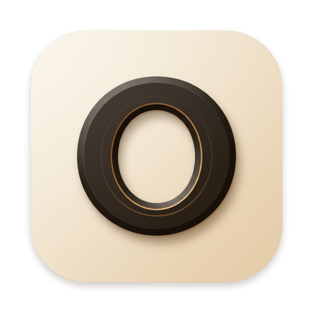

<div align="center">



<h1>Oatmeal</h1>

<p>
  <b>A local-only AI meeting notepad for Apple Silicon Macs.</b>
  <br />
  Granola-style notes, live on-device transcription, Ollama summaries, and MCP — without sending your meetings to the cloud.
</p>

<p>
  <a href="https://github.com/zczhuang/oatmeal/stargazers"></a>
  <a href="LICENSE"></a>
  
  
</p>

</div>

<br />

> **Built on [Anarlog](https://github.com/fastrepl/anarlog):** Oatmeal is an open-source, local-only fork of **[Anarlog](https://github.com/fastrepl/anarlog)** by [Fastrepl](https://github.com/fastrepl) (MIT, see [`LICENSE`](LICENSE)). Full credit for the core desktop app, audio capture architecture, editor, and database goes to the Anarlog / Hyprnote team.

## What Oatmeal does

Oatmeal captures meeting audio directly on your Mac (no bot joins your call), transcribes live on Apple Silicon, enhances your typed notes using a local [Ollama](https://ollama.com) model, and exposes your meeting history to coding agents via a read-only local MCP server.

### Key features

- **100% local audio, transcription, and summaries (`LOCAL_ONLY`):**
  - Telemetry, crash reporting, cloud sync, hosted STT/LLM providers, sign-in, and auto-updates are locked off at build time.
  - **Live transcription** runs on-device with **Parakeet v3 Live** (Neural Engine) or **Apple Speech**, with an optional **Whisper large-v3-turbo** post-meeting pass for Mandarin or mixed-language meetings.
  - **Enhanced notes** run through local **Ollama** (e.g. `gemma4:26b-mlx` or `gemma4:12b-mlx`), keep your typed lines verbatim as the outline, attach clickable timestamped transcript citations under each bullet, match the transcript's spoken language, and automatically chunk multi-hour meetings.
- **Granola-style meeting detection & auto-summary:**
  - Detects active Zoom, Microsoft Teams, Webex, and Slack calls within ~3 seconds (`Meeting detected` → `Take notes`).
  - Automatically stops capture ~5 seconds after the meeting ends and switches straight into **Summary** mode.
- **Direct local Google Calendar & Apple Calendar sync:**
  - Connects directly to Google Calendar API v3 from your Mac using your own Google Cloud Desktop OAuth 2.0 credentials (PKCE + loopback) with zero cloud relay, alongside native Apple Calendar support and scheduled meeting auto-start/auto-join.
- **Speaker labeling:**
  - Separates microphone ("you") and system audio ("remote") channels, reads Zoom/Teams speaking cues via macOS Accessibility, and combines them with voiceprints and calendar attendees.
- **Local MCP server for AI coding agents:**
  - Built-in stdio MCP server (`oatmeal-mcp`) works out of the box with **Claude Code**, **Codex**, **Antigravity**, and **Claude Desktop** — read-only by default over your local SQLite database.

## What runs where

| Stage | Where it runs |
| --- | --- |
| Audio capture & recording | Your Mac (Core Audio tap + mic, no call bot) |
| Live transcription | On-device (Parakeet v3 Live / Apple Speech) |
| Post-meeting Mandarin/mixed pass | On-device (Whisper large-v3-turbo, optional) |
| Enhanced notes & summaries | Local Ollama (`127.0.0.1:11434`) |
| Notes, transcripts & audio | Local SQLite (`~/Library/Application Support/anarlog/app.db`) |
| Calendar sync (optional) | Local Apple Calendar, or direct local Google Calendar OAuth |
| Agent access (MCP) | Local stdio process (read-only by default, no network listener) |

## Quick start (macOS Apple Silicon)

See **[SETUP.md](SETUP.md)** for full build, signing, and configuration instructions, and **[docs-local/MCP.md](docs-local/MCP.md)** for connecting Claude Code, Codex, Antigravity, or Claude Desktop.

```sh
git clone https://github.com/zczhuang/oatmeal.git
cd oatmeal

# Recommended if your parent folder path contains spaces:
export CARGO_TARGET_DIR="$HOME/.cargo-target/oatmeal"

# Pull a local notes model in Ollama
ollama pull gemma4:26b-mlx   # or gemma4:12b-mlx for lower RAM usage

# Install dependencies and launch dev mode
pnpm install
pnpm dev:desktop
```

### MCP setup (Claude Code, Codex, Antigravity)

```sh
cargo build --release -p anarlog-cli
mkdir -p ~/.local/bin
cp "$CARGO_TARGET_DIR/release/anarlog" ~/.local/bin/oatmeal-mcp
codesign --force --sign - ~/.local/bin/oatmeal-mcp

# Register in Claude Code
claude mcp add --scope user oatmeal -- ~/.local/bin/oatmeal-mcp \
  --db-path "$HOME/Library/Application Support/anarlog/app.db" mcp
```

See [docs-local/MCP.md](docs-local/MCP.md) for Codex (`~/.codex/config.toml`), Antigravity (`~/.gemini/config/mcp_config.json`), and Claude Desktop snippets.

## Repository map

| Path | Description |
| --- | --- |
| `apps/desktop` | Tauri v2 macOS desktop app (React/TypeScript UI + Rust backend) |
| `apps/cli` | Local CLI and stdio MCP server (`anarlog-cli` / `oatmeal-mcp`) |
| `crates/enhanced-notes` | Local Ollama note-enhancement engine, chunking, and transcript citations |
| `crates/calendar` | Apple Calendar and direct local Google Calendar OAuth + API v3 client |
| `crates/transcribe-soniqo` | On-device Parakeet v3 Live VAD-windowed transcription |
| `plugins/*` | Tauri plugins for detection, transcription, calendar, templates, and storage |
| `tools/meeting-capture` | Native Swift Core Audio & macOS Accessibility helper |
| `docs-local/` | Oatmeal-specific local setup and MCP documentation |

## Credits & License

Oatmeal is a fork of **[Anarlog](https://github.com/fastrepl/anarlog)** (originally Hyprnote), created and maintained by **[Fastrepl](https://github.com/fastrepl)**. Huge thanks to the Fastrepl team and all Anarlog contributors for open-sourcing the foundation under the MIT license.

- Community application & Oatmeal additions: **[MIT License](LICENSE)**
- Upstream enterprise directory (`enterprise/`, unused in Oatmeal): [commercial](LICENSE.enterprise) — see [LICENSING.md](LICENSING.md)
